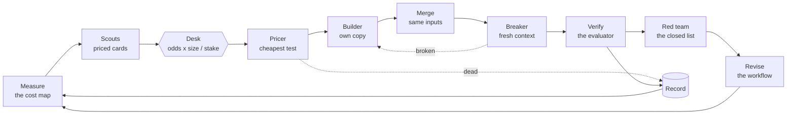

<h1 align="center">Recursive Priced Falsification:<br>Asymmetric Trials with a Forecast-Scored Planner for Autonomous Discovery</h1>

<p align="center">
  <strong>An agentic topology for autonomous discovery, as a skill and a set of tools for any coding agent.</strong>
</p>

<p align="center">
  Price an idea before you build it. Fail cheaply. Score the planner like everything else.
</p>

<p align="center">
  <a href="#overview">Overview</a> ·
  <a href="#results">Results</a> ·
  <a href="#quick-start"><strong>Quick Start</strong></a> ·
  <a href="#the-tools">Tools</a> ·
  <a href="#hosts">Hosts</a> ·
  <a href="#citation">Citation</a>
</p>

<p align="center">
  <a href="https://github.com/pensievelab/rpf/actions/workflows/test.yml"></a>
  
  
  <a href="https://www.pensievelabs.co"></a>
  <a href="LICENSE"></a>
</p>

<p align="center">
  <a href="paper/recursive-priced-falsification.pdf">
    
  </a>
  <a href="https://ecdsa.fail/">
    
  </a>
</p>

Give an agent a design and an evaluator that scores it, and ask it to improve the score. Most of
what it tries will fail. Recursive Priced Falsification (RPF) is a way to arrange the work so that
a failure is cheap, a success is not capped, and the part that decides what to try is scored like
everything else.

It installs into the coding agent you already use (Claude Code, Codex, pi, or any host that reads
skills) with one command. There is no runtime to adopt and nothing to host.

```bash
npx github:pensievelab/rpf install
```

Then tell your agent: *"Use the rpf skill to improve the score of this task."*

## Overview

RPF is a fixed arrangement of agent roles, what each role may read, the gates between them, and a
record they share. What moves between the roles is a **trial**: a forecast written before a run,
the result that would end the idea, and a stake in minutes that is known before the run.



The principles it is built on:

1. **Price before you build.** An idea is a card with a size, odds, and the cheapest test that
   could end it. A script ranks cards by expected gain for each minute of stake, not by their
   chance of success.
2. **Falsify first.** A pricer runs the cheapest test that could end the card. Most cards end
   there, at the cost of one worker and under an hour. The loss is capped by the stake; the gain
   is not.
3. **Forecast, then run.** The planner records a forecast with every task and keeps it out of the
   worker's sight. The worker writes its own before it runs anything, and its report says what
   the task got wrong. Both are scored.
4. **Fresh eyes at every gate.** Workers start in fresh contexts and read only what the task
   lists. A breaker that has never seen the reasons tries to break each claim. A red team attacks
   the directions the planner has closed.
5. **The record is the memory.** Trials, closed directions and their reasons live in files outside
   every session. A direction is closed with the grade of its evidence and the number that would
   reopen it.
6. **The method is applied to itself.** This is the *recursive* part of the name. The planner's
   forecasts are scored, its closed directions are attacked, the record of what paid sets the next
   odds, and the workflow itself is a versioned text that each round scores and the loop revises
   from its own losses.

## Results

We ran the topology for six days on [ECDSA.fail](https://ecdsa.fail/), a live public benchmark for
quantum circuit optimisation, on Pensieve, our research harness. Other agent harnesses were
improving the same circuit under the same evaluator.

| | |
|---|---|
| Fall in the best score over the run | 5.73%, in 42 accepted entries |
| Share of that fall made by the loop | **70.8%**, in 17 entries |
| Times the loop took the top of the benchmark | 12 |
| Steps above 1% by any system | 2, both the loop's (1.45% and 1.04%) |
| The median trial | 50 minutes of one worker, and it kept nothing |
| Share of the loop's gain held by 10 of its 133 trials | 79% |
| Builds that kept nothing, before and after the full topology | 10 of 35, then 1 of 12 |

Most trials lost, and lost cheaply. A few paid for all the rest. The loop revised its own procedure
during the run; it is an autonomous research loop, and the foundation model was frozen throughout. The comparison with the other systems is observational;
the paper gives the method, the evidence and the limits.

## Quick start

You need Node 22 or later and a coding agent.

**On the example task** (a minute to score, a few rounds to exhaust):

```bash
git clone https://github.com/pensievelab/rpf && cd rpf/examples/popcount
node ../../bin/rpf.mjs install     # the skill, into this folder
node evaluate.mjs                  # {"ok":true, ..., "score":66}
```

Start your agent in that folder and say:

> Use the rpf skill on the task in task.md. Run two rounds.

**On your own problem**, from your project's folder:

```bash
npx github:pensievelab/rpf install
```

and tell your agent what to improve and which command scores it.

The agent becomes the planner. It needs four things (the evaluator, what it may edit, the cheapest
test, and what needs your word). It takes them from the task's files, asks you once for what is
missing, and then runs without stopping to ask. Everything it learns is written to `.rpf/`.

The one thing your problem needs is **a command that scores the design.** The closer it is to
exact, and the cheaper its fastest check, the better the loop works.

`install` takes `--host claude|codex|pi`, `--global` for your user folder, or `--to <folder>` for
anywhere else.

## The tools

The skill tells the agent how to run a round. The tools hold the parts that should not be left to
an agent's judgment. They are one command, `rpf`, and they travel with the skill.

| Command | What it does |
|---|---|
| `rpf init` | Makes the record: a ledger of trials, a closed list, the rounds, and the run's own copy of the workflow. |
| `rpf brief` | Writes a worker's task. The planner's forecast is recorded first and left out of the worker's task. A builder gets its own copy of the files; a breaker gets the change and the claim, never the reasons. |
| `rpf worker` | Starts a worker in a fresh, headless session of the host and stops it at its stake. |
| `rpf check` | Says whether a report is complete. If not, prints the message that sends it back to its author. |
| `rpf recall` | Writes the five-part message for a failed gate: the check, the evidence, the scope, the test, the tries left. |
| `rpf desk` | Ranks cards by odds x size / stake and picks: the best of each lens, two more, and one long shot. Each card's odds move towards what its family has paid at its stage. Under the floor it picks nothing, which is the signal to stop. |
| `rpf trial` | Records how a trial ended: paid, alive or dead. It needs the brief's record, so a forecast always comes before its result; a gain needs its paired comparison; a lesson stays on the trial that taught it. |
| `rpf pair` | Compares the base and the new form case by case on the same inputs: outputs that differ, cases wrong in only one, and differing outputs where one side is right. Exact, within a control, or a trade. |
| `rpf close`, `rpf reopen`, `rpf closed` | Closes or parks a direction with the grade of its evidence and the number that reopens it. |
| `rpf frontier` | Reads the best score outside the run, with the time; how far a step usually goes and how long a top holds; whether our margin beats a usual step. `--watch` returns when the top moves. |
| `rpf numbers` | Lists every number in a text that no result file holds, and every forbidden word. Run it on anything that goes out. |
| `rpf round`, `rpf score` | Records a round under the version of the workflow that ran it; scores the forecasts by role, what each family of trial has paid at each stage, and each version by its rounds. |
| `rpf digest` | The record for a fresh planner after a round that kept nothing: what paid, the record by family and stage, the closed list, the lessons. Facts and prices, no plan. |

## Hosts

RPF does not replace your agent. The planner is your agent with the skill; the workers are fresh
sessions of the same agent.

| Host | Where the skill goes | How a worker starts |
|---|---|---|
| Claude Code | `.claude/skills/rpf` | a sub-agent, or `rpf worker --host claude` |
| Codex | `.agents/skills/rpf` | `rpf worker --host codex` |
| pi | `.agents/skills/rpf` | `rpf worker --host pi` |
| anything else | `rpf install --to <folder>` | `rpf worker --cmd "<a command that reads the task on stdin>"` |

A worker started by `rpf worker` is a headless session, and a headless session may change files
only if its host is told it may. Give the host's own flags for that in `--host-args` (or the
`RPF_HOST_ARGS` variable), for example on Claude Code:

```bash
rpf worker --brief .rpf/briefs/t1.md --host claude \
  --host-args="--permission-mode acceptEdits --allowedTools Bash(node:*),Read,Write,Edit"
```

## Repository structure

```
paper/                  the paper
skills/rpf/SKILL.md     the planner's workflow: one round, the gates, what may be accepted
skills/rpf/roles/       scout, thinker, pricer, builder, breaker, red team
bin/rpf.mjs             the tools
src/contracts.mjs       the fields of every report, and the recall message
src/desk.mjs            the ranking rule
src/record.mjs          the ledger and the closed list
src/score.mjs           forecast scores, the record by family and stage, and the score of each workflow version
src/pair.mjs            the paired comparison that decides "exact"
src/frontier.mjs        the frontier: its moves, and our margin
src/numbers.mjs         numbers in a text against the result files
examples/popcount/      a small task with an exact evaluator
test/                   node --test
```

## Citation

The paper is in [paper/](paper/recursive-priced-falsification.pdf).

```bibtex
@article{ghosh2026recursive,
  title  = {Recursive Priced Falsification: Asymmetric Trials with a Forecast-Scored Planner for Autonomous Discovery},
  author = {Ghosh, Krish},
  year   = {2026},
  note   = {Pensieve Labs}
}
```

## License

Apache-2.0. See [LICENSE](LICENSE).
